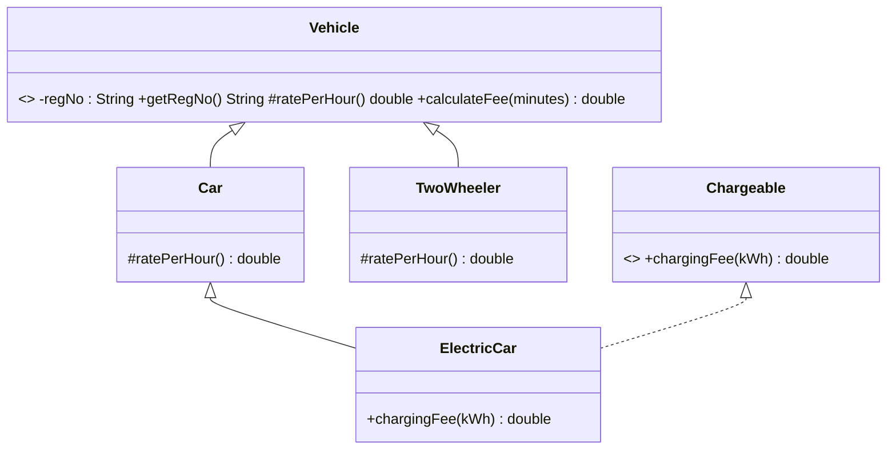

# Task 6 – Inheritance Hierarchy
Code: `ConstructorTrace.java` (output in `output.txt`).

## Hierarchy (multilevel + hierarchical inheritance)

```
            Vehicle (abstract)                  <<interface>> Chargeable
            /            \                              ^
      TwoWheeler         Car                            : implements
                          |                             :
                     ElectricCar -----------------------'
```
- `Vehicle → TwoWheeler`, `Vehicle → Car` = **hierarchical**; `Vehicle → Car → ElectricCar` = **multilevel**. Java has no multiple class inheritance, so `ElectricCar` gets the charging behaviour through an interface.
- Users (student/staff/visitor) are modelled as an `enum UserCategory` rather than subclasses: they differ only in a value (fee waiver), not in behaviour, so subclasses would be over-engineering.

## Inherited vs added
| Class | Inherits | Adds / overrides |
|---|---|---|
| `Vehicle` | – | `regNo`, `calculateFee`, abstract `ratePerHour` |
| `TwoWheeler` | everything | `ratePerHour() = 10` |
| `Car` | everything | `ratePerHour() = 30` |
| `ElectricCar` | all of `Car` | `chargingFee()` (+ battery in the demo) |

## `super`
- Constructor: `super(regNo)` must be the first statement and hands the registration number to the parent which stores it (it is `private`, so subclasses reach it only through `getRegNo()`).
- Method: `super.describe()` reuses the parent's behaviour inside an override.
- Field: `super.field` would reach a hidden parent field (avoided – fields are private).

## Constructor trace for `new ElectricCar("TN03C3", 40)`
1. `ElectricCar(...)` called → first line `super(regNo)` jumps up to `Car`
2. `Car(...)` → `super(regNo)` jumps up to `Vehicle` (→ implicitly `Object()` first)
3. `Vehicle` body runs → prints "1. Vehicle…"
4. back in `Car` → body runs → prints "2. Car…"
5. back in `ElectricCar` → field `batteryKWh` assigned, body runs → prints "3. ElectricCar…"
Order of **execution**: Object → Vehicle → Car → ElectricCar (top-down), although the calls go bottom-up.

## Alternative concept – composition
```java
class VehicleType { final String name; final double rate; }          // has-a
class Vehicle { final String regNo; final VehicleType type;
  double calculateFee(int min){ return ((min+59)/60) * type.rate; } }
Vehicle car = new Vehicle("TN02B2", new VehicleType("CAR", 30));
```
| | Inheritance | Composition |
|---|---|---|
| Add a new vehicle type | new subclass (1 new class, no edits) | new data row `new VehicleType("VAN", 60)` – no new class at all (best when types differ only in data) |
| Different *behaviour* (flat fee, peak hours) | override method – easy | need a strategy object inside `VehicleType`, more indirection |
| Fee time | O(1) – virtual call | O(1) – one field read + one call |
| Space per vehicle | object header + regNo ref | object header + regNo ref + type ref (+8 B) but the `VehicleType` objects are shared (flyweight), so O(1) extra overall |
Rule of thumb: "is-a" for behaviour differences, "has-a" for data differences.
